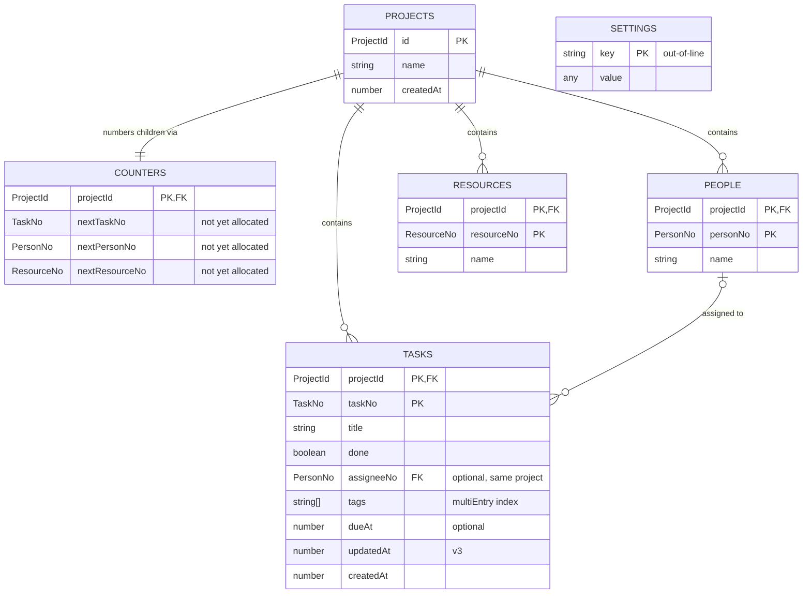

## This is just boilerplate

This is boilerplate generated by Claude and needs to be rewritten to suit the
actual schema used by SailCalc!

## Introduction

Database `app`, current version **3**. Source of truth: `src/db-schema.ts`; ID
types in `src/ids.ts`.

## Identifiers

| Suffix | Meaning                                           | Types                                 |
| ------ | ------------------------------------------------- | ------------------------------------- |
| `Id`   | Globally unique on its own (UUID string)          | `ProjectId`                           |
| `No`   | Sequential number, unique only within its project | `TaskNo`, `PersonNo`, `ResourceNo`    |
| `Key`  | Full IndexedDB primary key: `[ProjectId, …No]`    | `TaskKey`, `PersonKey`, `ResourceKey` |

All are branded types: identical to `string` / `number` at runtime, distinct to
the compiler.

Child numbers start at 1 and are allocated from the project's `counters` record
inside the same readwrite transaction that adds the child, so they are unique
per project even across tabs. They are **not** unique across devices.

## Relationships

IndexedDB does not enforce relationships; these are conventions maintained in
application code.

## Stores

### `projects`

| Key           | Auto-increment |
| ------------- | -------------- |
| in-line, `id` | no             |

No indexes.

### `counters`

| Key                  | Auto-increment |
| -------------------- | -------------- |
| in-line, `projectId` | no             |

No indexes. One record per project, created with it. Kept apart from `projects`
because IndexedDB rewrites whole records: allocating a child number rewrites
only this small record and doesn't contend with edits to the project.

### `tasks`

| Key                                     | Auto-increment |
| --------------------------------------- | -------------- |
| in-line, compound `[projectId, taskNo]` | no             |

A project's tasks, in number order: key range `[pid, 1]` to `[pid, Infinity]` on
the store itself.

| Index            | Key path             | Unique | Multi-entry | Serves                                                                       | Since |
| ---------------- | -------------------- | ------ | ----------- | ---------------------------------------------------------------------------- | ----- |
| `by-tag`         | `tags`               | no     | yes         | Tasks with a given tag, across all projects                                  | v2    |
| `by-project-due` | `[projectId, dueAt]` | no     | no          | Project tasks ordered or ranged by due date. Excludes tasks with no `dueAt`. | v3    |

### `people`

| Key                                       | Auto-increment |
| ----------------------------------------- | -------------- |
| in-line, compound `[projectId, personNo]` | no             |

No indexes. A project's people: same key-range pattern as `tasks`.

### `resources`

| Key                                         | Auto-increment |
| ------------------------------------------- | -------------- |
| in-line, compound `[projectId, resourceNo]` | no             |

No indexes. A project's resources: same key-range pattern as `tasks`.

### `settings`

| Key                        | Auto-increment |
| -------------------------- | -------------- |
| out-of-line (setting name) | no             |

Values are stored bare (`string | number | boolean | null`).

## Version history

| Version | Changes                                                                 | Data migration                          |
| ------- | ----------------------------------------------------------------------- | --------------------------------------- |
| 1       | Created `projects`, `counters`, `tasks`, `people`, `resources`          | —                                       |
| 2       | Added multi-entry index `tasks.by-tag`                                  | —                                       |
| 3       | Added `tasks.by-project-due`, store `settings`, field `tasks.updatedAt` | Backfilled `updatedAt` from `createdAt` |
